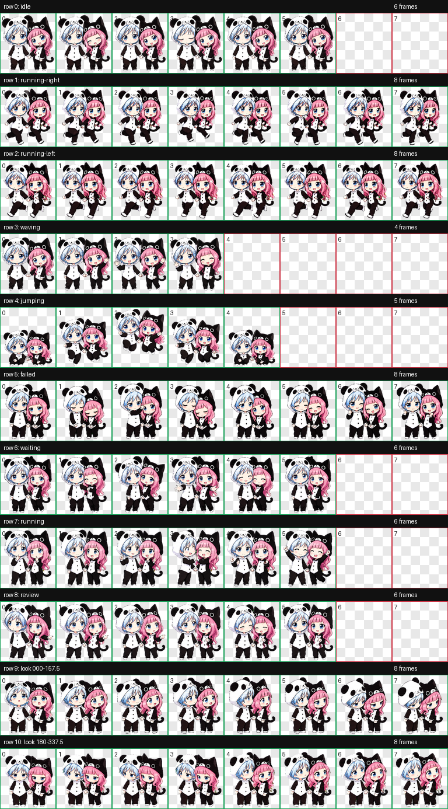

# 九月与十月 · ChatGPT 双人桌宠

这是一个以《偷星九月天》九月与十月为灵感制作的非官方 Q 版双人 ChatGPT Work 桌宠。两人被设计为一个动画单位：十月固定在左侧，九月固定在右侧，通过牵手、挥手、跳跃、协作和互相安慰保持互动。



## 快速安装

使用前需要你的 ChatGPT Work 环境支持 **Pets**。

1. 在本仓库页面点击 **Code → Download ZIP**，解压文件。
2. 找到根目录中的 `spritesheet.png`。
3. 在 ChatGPT Work 中新建对话并启用 **Pets**。
4. 将 `spritesheet.png` 作为附件上传，然后发送下面这段话：

   ```text
   请使用 Pets 验证并创建这个 v2 桌宠。
   名称：九月与十月
   描述：《偷星九月天》九月与十月的双人互动Q版桌宠：牵手、挥手、跳跃、协作与互相安慰。
   创建成功后请将它设为当前桌宠。
   ```

5. 等待 Pets 返回验证成功和宠物 ID。若你的账户没有 Pets 创建功能，请确认工作区是否已开放该功能。

## 动画与触发状态

| 状态 | 由 Pets/Codex 触发的场景 | 动画设计 |
| --- | --- | --- |
| `idle` | 空闲待机 | 牵手呼吸、轻微起伏、交替眨眼 |
| `running-right` | 桌宠向右移动 | 两人牵手向右迈小步 |
| `running-left` | 桌宠向左移动 | 保持人物顺序，牵手向左迈小步 |
| `waving` | 打招呼或吸引注意 | 九月先挥手，两人一起挥，十月害羞收尾 |
| `jumping` | 跳跃或活跃反馈 | 牵手下蹲、起跳、腾空、落地 |
| `failed` | 任务失败、取消或受阻 | 沮丧后互相安慰，再重新振作 |
| `waiting` | 等待批准、选择或补充信息 | 拉衣袖、歪头、伸手等待回应 |
| `running` | Codex 正在执行任务 | 思考、交换眼神、击掌协作；不是跑步 |
| `review` | 检查或展示结果 | 一起查看、指示、点头确认 |
| 16 向注视 | Pets 调整角色注视方向 | 眼睛先移动，头部与发梢轻微跟随 |

实际切换时机由 Pets 客户端控制。图集只定义每个状态播放时显示的动画，不会自行监听鼠标或修改客户端逻辑。

## 预览

| 静息 | 跳跃 | 处理中 | 失败安慰 |
| --- | --- | --- | --- |
|  |  |  |  |

其余动画位于 [`previews/`](previews/)；16 向注视检查图位于 [`docs/direction-qa.png`](docs/direction-qa.png)。

## 技术规格

- ChatGPT Pets v2 精灵图
- PNG，RGBA 透明背景
- 尺寸：`1536 × 2288`
- 网格：8 列 × 11 行
- 单元格：`192 × 208`
- 必需动画帧：73
- 官方 Pets 预检：通过
- 本地质量门槛：通过

`qa/` 中包含结构验证、动画质量和方向语义检查结果。

## 文件说明

```text
spritesheet.png       最终可导入的 v2 精灵图
pet.json              宠物元数据示例
docs/                 状态总览与方向检查图
previews/             九种标准状态的 GIF 预览
qa/                   验证和质量检查报告
```

## 版权说明

这是粉丝创作的非官方、非商业作品，与《偷星九月天》的原作者、出版社及权利方没有隶属或授权关系。原作角色及相关知识产权归各自权利人所有。请勿将本仓库素材用于商业销售、付费再分发、冒充官方内容或其他侵权用途。详见 [NOTICE.md](NOTICE.md)。

